<figure>
  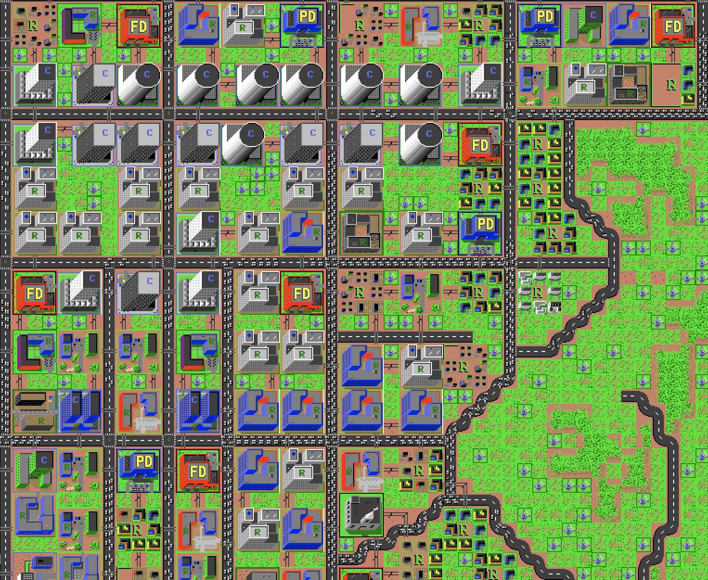
</figure>

[Micropolis](https://github.com/SimHacker/MicropolisCore) is the open-source release of the 1989 SimCity.

If you’ve never played the game, here’s the gist:

1. You set the size of 3 kinds of zone: residential, commercial, and industrial.
2. Once roads and power reach a zone, the game decides what gets built there and how dense it grows.
3. The game shows the growth of each zone, and you need to balance them.

Here’s how it’s implemented and the math that makes it fun.

**TL;DR:** To build a system that never rests, build it like a spring with no friction:

- let one part keep adding up its errors and another part act on that total so it always overshoots
- give the parts goals that can't all be met, and add a delay with hard limits so the bouncing never dies out or blows up.

---

The map is 120 × 100 tiles.

<figure>
  <video autoplay loop muted playsinline poster="/blog/images/micropolis_02_poster.png" aria-label="Zooming into the 120 by 100 tile map down to a single tile" style="width: 100%; height: auto;">
    <source src="/blog/images/micropolis_02.mp4" type="video/mp4">
  </video>
</figure>

Each tile is stored as one 16-bit integer. The top 6 bits are flags: whether the tile has power, whether it conducts power, whether it can burn, and so on. The low 10 bits are the tile ID, which allows 1,024 kinds of tile.

<figure>
  <video autoplay loop muted playsinline poster="/blog/images/micropolis_03_poster.png" aria-label="One tile as a 16-bit integer: 6 flag bits (powered, conducts power, burnable, bulldozable, animated) and a 10-bit tile ID" style="width: 100%; height: auto;">
    <source src="/blog/images/micropolis_03.mp4" type="video/mp4">
  </video>
</figure>

On top of the tile map, the engine keeps several numeric maps: traffic, pollution, land value, crime, and police and fire coverage.

<figure>
  <video autoplay loop muted playsinline poster="/blog/images/micropolis_04_poster.png" aria-label="Overlay maps such as traffic and pollution stacked above the tile map" style="width: 100%; height: auto;">
    <source src="/blog/images/micropolis_04.mp4" type="video/mp4">
  </video>
</figure>

The game state is a discrete-time dynamical system. The next state depends only on the current state and a RNG.

<figure>
  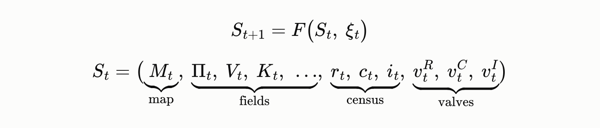
</figure>

A minor optimization: the maps run at different resolutions.

Time advances in phases, and 16 phases make one game week.

- Phases 1-8: process 1/8 of the map.
- Phase 9: census and taxes.
- Phases 10-15: recompute traffic, power, pollution and land value, crime, population density, and fire coverage.

---

If you know me, you know that I see everything as a feedback loop. Here’s the feedback loop of the map.

<figure>
  <video autoplay loop muted playsinline poster="/blog/images/micropolis_06_poster.png" aria-label="Feedback loop: the map feeds the census and the field maps (traffic, power, coverage, pollution, land value, density, crime); census drives demand valves, field maps drive location score, both drive zone growth, which rewrites the map" style="width: 100%; height: auto;">
    <source src="/blog/images/micropolis_06.mp4" type="video/mp4">
  </video>
</figure>

---

Now the fun part.

The game steers growth with three numbers called demand valves, one each for residential, commercial and industrial. A positive valve makes zones of that kind more likely to grow, and a negative valve makes them more likely to decline. Every two weeks the engine nudges each valve up or down, and the valve holds its new value until the next update. The residential valve ranges from −2000 to 2000; the other two range from −1500 to 1500.

<figure>
  <video autoplay loop muted playsinline poster="/blog/images/micropolis_07_poster.png" aria-label="Census bars for residential, commercial and industrial next to the three demand valves moving week by week as the tax rate changes" style="width: 100%; height: auto;">
    <source src="/blog/images/micropolis_07.mp4" type="video/mp4">
  </video>
</figure>

Each nudge has three inputs: the census population, a projection of what that population should be, and the tax rate. The engine compares each population with its projection, turns the gap into a step, adds a tax adjustment to the step, and adds the result to the valve.

**Population.** The census counts the population of each kind of zone. Residential population is counted on a different scale, so the engine divides it by 8 to put all three in the same units. Commercial and industrial population together count as jobs, J.

<figure>
  
</figure>

**Projection.** For each kind of zone, the engine projects the population that the rest of the city can support. Each projection follows a different driver:

- Residential follows jobs: current residents, plus migrants who arrive when jobs outnumber residents (or leave when they don’t), plus 2% births.
- Commercial follows the whole city: total population divided by 3.7, scaled by the labor ratio L, which counts residents per job and stops at 1.3.
- Industrial follows outside markets: current industry scaled by L and by a factor e that depends on difficulty.

Since every projection reads the other populations, growth in one kind of zone moves the targets for the other two. J and L come from the previous census, so the projections run one census behind.

<figure>
  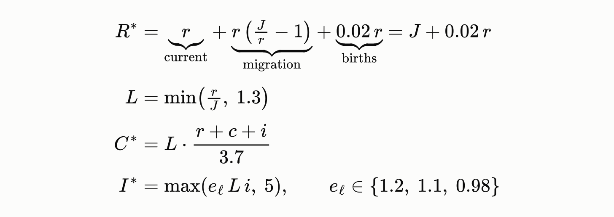
</figure>

**Gap.** The engine divides each projection by its population to get a ratio ρ, capped at 2. The step is 600 × (ρ − 1). A population exactly at its projection gives a step of 0. Residents 10% below their projection give ρ ≈ 1.11 and a step of about +67. A population above its projection gives a negative step.

<figure>
  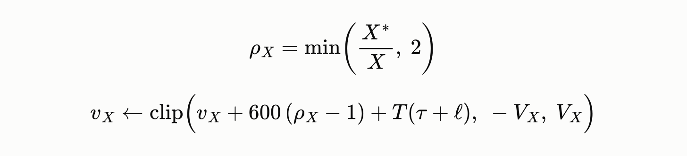
</figure>

The update adds a tax term T from a fixed table, 0 at 7% tax on easy. The limits are VR = 2000 and VC = VI = 1500.

So a valve holds still only at one ratio:

<figure>
  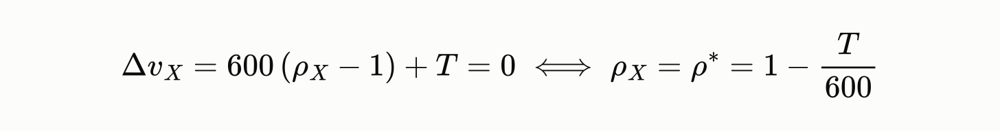
</figure>

With the census fixed at r = 400, c = 200 and i = 250, the ratios are 1.145, 1.021 and 1.067, so every update adds 86, 12 and 40. At 12% tax, T = −200 and the same gaps drain the valves.

---

### No point where every valve holds still

Residential and industrial depend on a single number, q = r/J:

<figure>
  
</figure>

Both hold still only if q solves two equations at once:

<figure>
  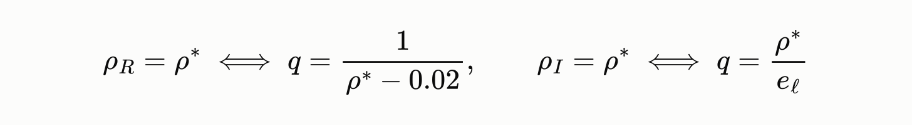
</figure>

That requires

<figure>
  
</figure>

and no difficulty meets it:

<figure>
  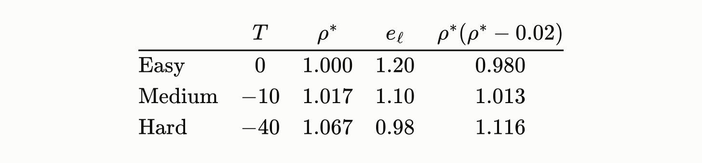
</figure>

In residential share p = q/(1 + q), the two balance points sit apart on every difficulty. On easy:

<figure>
  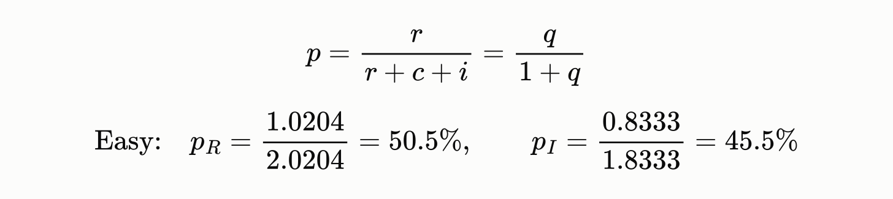
</figure>

<figure>
  <video autoplay loop muted playsinline poster="/blog/images/micropolis_17_poster.png" aria-label="Valve change per update against residential share for each difficulty: the residential and industrial curves cross zero at different shares" style="width: 100%; height: auto;">
    <source src="/blog/images/micropolis_17.mp4" type="video/mp4">
  </video>
</figure>

---

### Why the city never comes to rest

Rest means every valve and every population holds still. The proof takes two steps. Step 1 shows that residential and industrial can't both hold still. Step 2 shows that a valve which could hold still on its own circles its target instead.

**Step 1: one valve always runs.** On easy at 7% tax, ρ\* = 1 and e = 1.2. Each gap changes sign at exactly one value of q, and so at exactly one residential share:

<figure>
  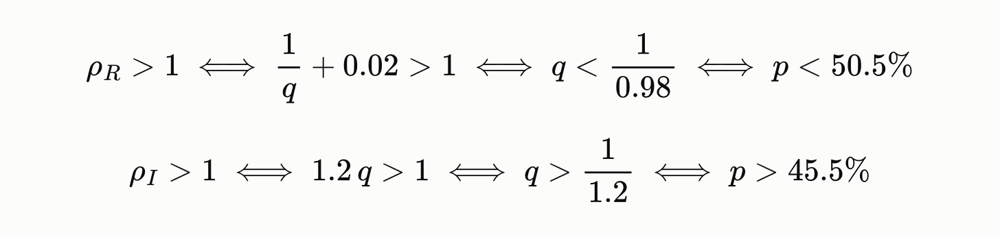
</figure>

Side by side, the two thresholds split the residential share into three ranges:

<figure>
  
</figure>

A positive gap raises a valve, and a rising valve grows zones of that kind. New housing raises p and new industry lowers it. So below 45.5% both valves push p up, and above 50.5% both push it down, which drives the point into the band between them. Inside the band both gaps are positive, so both valves climb on every update and only their limits stop them:

<figure>
  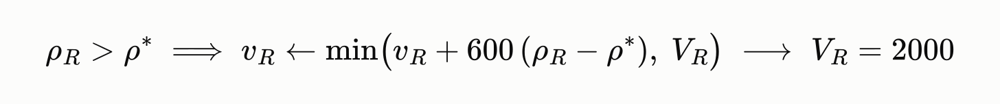
</figure>

The engine agrees. In the lab city, the residential valve sits at VR = 2000 for 92% to 96% of the time. A pinned valve stops moving, but the limit holds it there and no balance does. The best the whole system can manage is residential pinned at its limit while commercial and industrial each try to balance on their own. Step 2 shows they can’t.

**Step 2: a valve that can balance circles instead.** First, how a valve turns into growth. A zone grows or declines with probabilities set by its score z = v + s, where s is its location score:

<figure>
  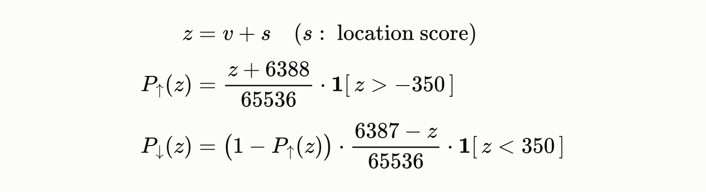
</figure>

The net growth rate g stays near zero inside a dead zone around z = 0, then jumps to about ±10%:

<figure>
  <video autoplay loop muted playsinline poster="/blog/images/micropolis_22_poster.png" aria-label="Net change per evaluation against score z: near zero inside a dead zone from −350 to 350, jumping to about ±10% outside it" style="width: 100%; height: auto;">
    <source src="/blog/images/micropolis_22.mp4" type="video/mp4">
  </video>
</figure>

Now take commercial and hold the rest of the city fixed. Let c\* be the population where its gap is zero, and x = c − c\* the distance from it. The gap σ(x) falls as c rises, because r and i stay fixed while c grows:

<figure>
  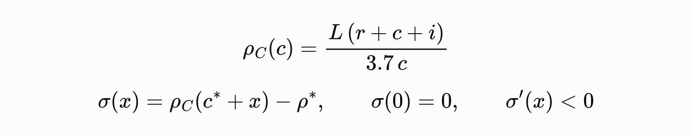
</figure>

Valves and zones both move in small steps, so treat time as continuous. The valve gains 600σ every two weeks, which is 300σ per week, and the population changes at the growth rate g:

<figure>
  
</figure>

Outside the dead zone, the signs alone make the state rotate. Read the table row by row. Below target with a negative valve, the gap is positive, so the valve rises. Once the valve turns positive, the population grows. Past the target the gap turns negative and the valve falls, yet the population keeps growing until the valve itself turns negative. Then the population shrinks back below target, and the first row repeats.

<figure>
  
</figure>

A rotation could still spiral inward and stop. To rule that out, define H as the sum of two parts. The first, Φ(v) = ∫g, measures how hard the valve pushes. The second, Ψ(x) = −300∫σ, measures how far the population sits from target. Neither is ever negative, and their sum is zero only at rest: on target, with the valve inside the dead zone. As the state moves, each part changes at a rate the other exactly cancels:

<figure>
  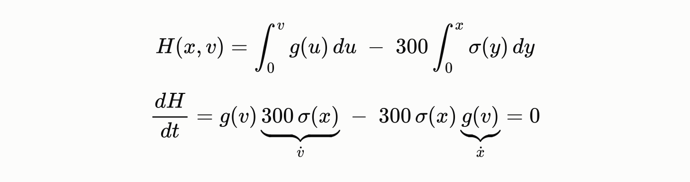
</figure>

So H never changes. Rest has H = 0, so a city that starts anywhere else, with H > 0, can never get there. Its state stays on the closed curve H = H0 around the target and goes round it forever, the way a frictionless pendulum trades speed for height and never stops. The engine’s commercial loop traces these curves clockwise, in the same order as the table:

<figure>
  <video autoplay loop muted playsinline poster="/blog/images/micropolis_27_poster.png" aria-label="The engine&#x27;s commercial valve against commercial population tracing a closed clockwise loop over the years" style="width: 100%; height: auto;">
    <source src="/blog/images/micropolis_27.mp4" type="video/mp4">
  </video>
</figure>

Two effects keep a real city away from H = 0 for good. Inside the dead zone, net growth is +0.95% at z = 0 rather than zero, so even a city sitting exactly on target drifts off it. And the projections read an older census, which adds a little to H on every lap, so the loop widens until the valve limits of ±1500 cap it.

So the city has no resting state. The residential and industrial balance points never coincide, so one valve always runs to its limit. Each loop that can balance conserves H, so it circles its target forever, and the census lag only widens the circle.

---

## The recipe for a system that never rests

The proof explains this one system. The lesson worth keeping is how to build any system that never rests, and the rules above add up to a recipe with four ingredients.

**1. Remember errors, then act on the memory.** The valve adds up the gap on every update and forgets nothing. The population follows the valve, so it reacts to the running total of past gaps. Two accumulators feed each other in a loop. Straighten both curves near the target, and the loop becomes a mass on a spring:

<figure>
  
</figure>

A spring overshoots because the mass keeps its speed as it passes the rest point. Here the valve plays the part of speed. When the population reaches its target the gap is zero, but the valve still holds everything it added on the way in, so the population sails past.

**2. Leave out friction.** A spring stops only when something drains its energy. Give the valve a leak, so that it also decays toward zero at rate γ, and H starts to drain:

<figure>
  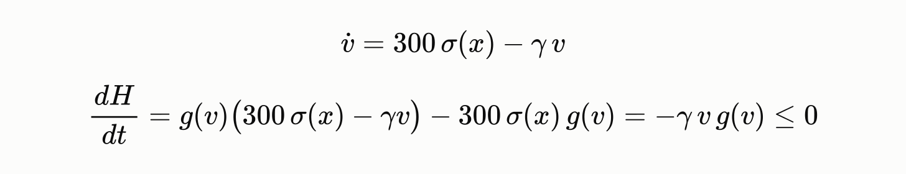
</figure>

Since g(v) always has the sign of v, the product v·g(v) is never negative. Any γ > 0 makes H fall until the loop comes to rest. Micropolis sets γ = 0, so the valve keeps every error until it hits a limit.

**3. Give the parts goals that can't all be met.** A leak would let commercial settle, but it can't repair step 1. Residential holds still only at a 50.5% residential share and industrial only at 45.5%, so even a damped city keeps one valve pinned. The conflict removes the global resting point, and the missing friction removes the local ones.

**4. Add a delay and hard limits.** A frictionless loop keeps whatever size it starts with. The census lag adds a little to H on every lap, and the valve limits cap how far it can grow, so the city ends up on one loop of fixed size, the one in the animation above.

<figure>
  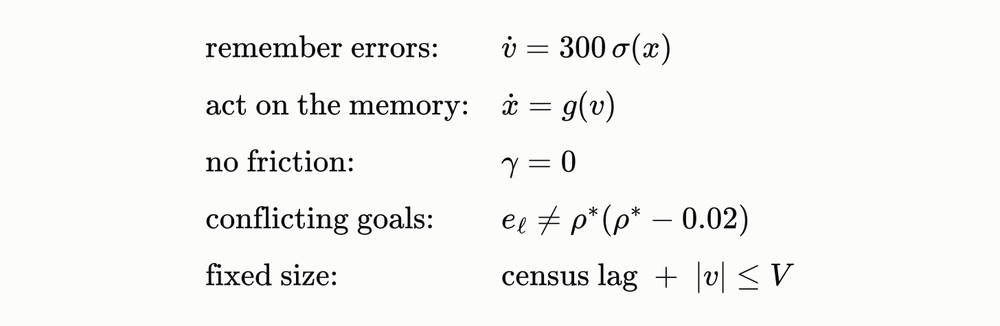
</figure>

The same structure turns up far from city games. Control engineers know it as integral control of a process that itself accumulates, a loop with nothing to damp it. Ecologists know it as the Lotka–Volterra predator–prey model, which also conserves a quantity and also cycles forever. In a game it works as a feature: a city that never settles always gives the player something to respond to.
